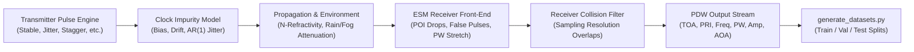
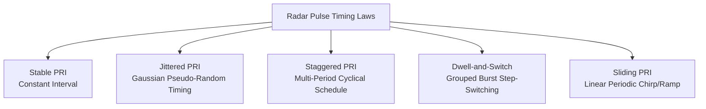
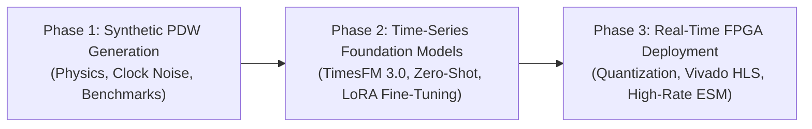

# PULSAR: Pulse-Level Synthetic Radar Benchmark & ESM Time-Series Forecasting

[](#)
[](#)
[](#)
[](#)

PULSAR is an Electronic Support Measures (ESM) / Electronic Intelligence (ELINT) simulation and time-series benchmark framework. It generates physically realistic Pulse Description Word (PDW) streams from diverse radar emitters, simulates real-world hardware clock imperfections, propagation path anomalies, and receiver constraints, and provides a benchmark pipeline for evaluating time-series foundation models (such as Google's TimesFM 3.0) on radar pulse forecasting and deinterleaving.

---

## Table of Contents
1. [Project Overview & Architecture](#1-project-overview--architecture)
2. [Physical Signal & ESM Measurement Model](#2-physical-signal--esm-measurement-model)
3. [Radar Parameter Selection & Physics Rationale](#3-radar-parameter-selection--physics-rationale)
4. [PRI Modulation Regimes](#4-pri-modulation-regimes)
5. [Hardware & Environmental Distortion Models](#5-hardware--environmental-distortion-models)
   * [5.1. Transmitter Clock Impurity Model & Metrology](#51-transmitter-clock-impurity-model--metrology)
   * [5.2. Atmospheric & Tropospheric Effects](#52-atmospheric--tropospheric-effects)
   * [5.3. Antenna Radiation Pattern & the 2.783 Sinc Constant](#53-antenna-radiation-pattern--the-2783-sinc-constant)
   * [5.4. ESM Receiver Distortions, CFAR & Collisions](#54-esm-receiver-distortions-cfar--collisions)
6. [Benchmark Dataset Suite & Modular Configuration System](#6-benchmark-dataset-suite--modular-configuration-system)
7. [Getting Started & Installation](#7-getting-started--installation)
8. [CLI Generator Usage Guide](#8-cli-generator-usage-guide)
9. [Visualization & Interactive Exploration](#9-visualization--interactive-exploration)
10. [Roadmap: Foundation Models & FPGA Deployment](#10-roadmap-foundation-models--fpga-deployment)

---

## 1. Project Overview & Architecture

Modern Electronic Warfare (EW) systems intercept radar signals across hostile environments. Rather than digitizing raw RF waveforms at gigasamples per second, modern ESM receivers process incoming RF pulses into compact metadata packets known as **Pulse Description Words (PDWs)**.

The PULSAR repository is structured into modular, decoupled components:

```text
Bitirme/
├── README.md                                  # Comprehensive documentation (this file)
├── PULSAR.md                                  # Core graduation thesis roadmap & specification
├── requirements.txt                           # Full project dependencies (Phase 1 & Phase 2)
├── .gitignore                                 # Excludes datasets, CSVs, build caches
├── .gitattributes                             # Strips notebook outputs via nbstripout
│
├── configs/                                   # MODULAR YAML PARAMETER CONFIGURATIONS
│   ├── radar_profiles.yaml                    # Fixed & varying profile sampling ranges
│   ├── error_levels.yaml                      # Channel noise, POI, multipath, false alarm levels
│   └── clock_noise.yaml                       # Oscillator bias, offset, drift, and jitter specs
│
├── synthetic_data_generation/                 # HIGH-FIDELITY RADAR SIMULATION ENGINE
│   ├── __init__.py                            # Package exposure for modular imports
│   ├── radar_generator.py                     # Physics engine: oscillators, env, scan, POI
│   └── demo.ipynb                             # Interactive physics & polar antenna visualization
│
├── dataset_generator/                         # REPRODUCIBLE BENCHMARK GENERATION SUITE
│   ├── __init__.py                            # Package init
│   ├── generate_datasets.py                   # Unified, high-throughput CLI benchmark generator
│   └── dataset_plotter.ipynb                  # Sequence inspection, diagnostics & polar plotter
│
└── datasets/                                  # BENCHMARK STORAGE (Ignored by Git)
    ├── single_radar/
    │   ├── fixed/
    │   │   └── <radar_type>/<seq_count>x<pulse_count>_<error_level>/
    │   └── varying/
    │       └── <radar_type>/<seq_count>x<pulse_count>_<error_level>/
    └── interleaved/
        └── <radar_count>radars_<seq_count>x<pulse_count>_<error_level>/
```

### Module Responsibilities:
* **`configs/`**: Plain-text YAML configuration files. Decouples experimental knobs (sampling ranges, noise standard deviations, oscillator parameters) from Python code.
* **`synthetic_data_generation`**: The core physical simulation engine. Implements pulse generation timing laws, non-ideal oscillator phase noise/drift, multi-beam antenna scan patterns, tropospheric refractivity, atmospheric attenuation, and receiver limitations.
* **`dataset_generator`**: A high-performance CLI utility that reads `configs/` and produces structured, reproducible machine learning datasets with strict train/val/test splits (70/10/20) and no data leakage.



---

## 2. Physical Signal & ESM Measurement Model

Each intercepted pulse is described by a 6-dimensional observation vector (PDW):

| Parameter | Unit | Classification | Description |
|---|---|---|---|
| **TOA** (Time of Arrival) | $\mu\text{s}$ | Directly Measured | Exact timestamp of the leading edge of the intercepted pulse at the receiver antenna. |
| **Measured $\Delta\text{TOA}$** | $\mu\text{s}$ | Derived Metric | Observed time difference between consecutive pulses: $\Delta\text{TOA}_n = \text{TOA}_n - \text{TOA}_{n-1}$. |
| **PRI** (Source PRI) | $\mu\text{s}$ | Ground Truth | The true transmitter interval intended by the radar. In non-ideal channels (missing/false pulses), Measured $\Delta\text{TOA} \neq \text{PRI}$. |
| **Frequency** | $\text{MHz}$ | Directly Measured | Carrier center frequency of the RF pulse. Supports fixed, agile, or frequency-hopping modes. |
| **PW** (Pulse Width) | $\mu\text{s}$ | Directly Measured | Duration between the leading edge (50% amplitude) and trailing edge of the pulse envelope. |
| **Amplitude** | $\text{dBm}$ | Directly Measured | Received RF peak power, coupled to distance, atmospheric attenuation, and antenna beam scan gain. |
| **AOA / DOA** | Degrees ($^\circ$) | Directly Measured | Angle of Arrival in azimuth ($0^\circ - 360^\circ$) at the receiver direction-finding antenna array. |

---

## 3. Radar Parameter Selection & Physics Rationale

The baseline parameters configured in PULSAR were selected based on operational radar engineering standards:

### 3.1. Carrier Frequency: $8900\text{ -- }9100\text{ MHz}$ (Center: $9000\text{ MHz}$)
* **Radar Band**: **X-Band** ($8\text{ -- }12\text{ GHz}$, wavelengths $\lambda \approx 3\text{ cm}$).
* **Operational Rationale**: X-band provides an optimal trade-off between atmospheric penetration and narrow antenna beamwidth (high angular resolution) with compact apertures. It is the dominant band for military airborne fire-control radars, missile interceptor seekers, and maritime surface search radars.
* **Frequency Agility & Hopping Regimes**:
  * **`constant`**: Single fixed RF carrier frequency.
  * **`hopping`**: Deterministic periodic cycling through discrete RF channels (e.g. $[8950, 9000, 9050, 9100]\ \text{MHz}$).
  * **`agility`**: Pseudo-random pulse-to-pulse carrier frequency switching across available channels as an Electronic Counter-Countermeasure (ECCM) to degrade narrowband spot/barrage jammers.

### 3.2. Pulse Repetition Interval: Mean $1000\ \mu\text{s}$ (Range: $800\text{ -- }1200\ \mu\text{s}$)
* **Radar Physics**: A $1000\ \mu\text{s}$ ($1\text{ ms}$) PRI yields a Pulse Repetition Frequency ($\text{PRF}$) of $1\text{ kHz}$.
* **Maximum Unambiguous Range**:
  $$R_{\text{unamb}} = \frac{c \cdot \text{PRI}}{2} = \frac{3 \times 10^8\text{ m/s} \times 10^{-3}\text{ s}}{2} = 150\text{ km}$$
* **Operational Rationale**: $150\text{ km}$ matches the standard tactical surveillance and early-warning horizon for airborne and ground-based surveillance radars against medium/high-altitude air targets.

### 3.3. Pulse Width: Mean $1.5\ \mu\text{s}$ (Range: $1.0\text{ -- }2.0\ \mu\text{s}$)
* **Range Resolution**: For an unmodulated rectangular pulse, range resolution is:
  $$\Delta R = \frac{c \cdot \text{PW}}{2} = \frac{3 \times 10^8 \times 1.5 \times 10^{-6}}{2} = 225\text{ m}$$
* **Operational Rationale**: In ESM signal deinterleavers, pulse width serves as a first-line discriminative feature to separate narrow-pulse tracking radars from long-pulse search radars.

### 3.4. Received Amplitude: $-65\text{ to } -45\text{ dBm}$
* **Operational Rationale**: Matches the linear dynamic range of high-performance ESM digital receivers. Signals weaker than $-75\text{ dBm}$ degrade into thermal noise, while signals exceeding $-30\text{ dBm}$ risk driving front-end Low Noise Amplifiers (LNAs) into non-linear compression.

---

## 4. PRI Modulation Regimes

PULSAR models the five fundamental pulse timing laws utilized across modern military radars:



### 1. Stable PRI (`StableRadar`)
* **Behavior**: Transmits pulses at a fixed, unvarying interval $T_0$:
  $$t_n = t_0 + n \cdot T_0$$
* **Application**: Baseline civilian navigation radars, marine radar, legacy search systems. Highly predictable and straightforward for ESM deinterleaving.

### 2. Jittered PRI (`JitterRadar`)
* **Behavior**: Adds a zero-mean Gaussian random variation to each successive interval:
  $$T_n = T_0 + \delta_n, \quad \delta_n \sim \mathcal{N}(0, \sigma^2)$$
  with $\sigma$ typically set between $4\%$ and $8\%$ of $T_0$.
* **Application**: Electronic Counter-Countermeasure (ECCM). Jitter prevents hostile Electronic Attack (EA) repeater jammers from locking on to the pulse stream and projecting false targets (e.g., Range-Gate Pull-Off / RGPO).

### 3. Staggered PRI (`StaggerRadar`)
* **Behavior**: Cycles through a deterministic repeating schedule of $M$ distinct pulse intervals:
  $$T_n = \text{PRI}[n \pmod M], \quad \text{e.g., } [850\ \mu\text{s}, 1000\ \mu\text{s}, 1150\ \mu\text{s}]$$
* **Application**: Moving Target Indication (MTI) radars. Single-PRF radars suffer from "blind speeds" where target Doppler shifts alias to integer multiples of the PRF. Cycling through multiple staggered PRIs shifts the blind speeds far outside the operational envelope.

### 4. Dwell-and-Switch PRI (`DwellAndSwitchRadar`)
* **Behavior**: Transmits a burst ("dwell") of $K$ pulses at interval $T_1$, then steps to $T_2$ for the next $K$ pulses:
  $$T_n = \text{PRI}_{\lfloor n / K \rfloor \pmod M}$$
* **Application**: Modern Phased Array and Active Electronically Scanned Array (AESA) multifunction radars. A radar dwells on a specific azimuth/elevation cell to integrate Doppler filters, then switches waveform parameters when pointing the pencil beam at a new track.

### 5. Sliding PRI (`SlidingRadar`)
* **Behavior**: Linearly ramps the interval from $T_{\text{start}}$ to $T_{\text{end}}$ across $P$ pulses, then resets or repeats:
  $$T_n = T_{\text{start}} + \left(\frac{n \pmod P}{P - 1}\right) \cdot (T_{\text{end}} - T_{\text{start}})$$
* **Application**: 3D elevation search radars and mechanically scanned helical/raster antennas to maintain range-velocity correlation across scanning angles.

---

## 5. Hardware & Environmental Distortion Models

To transition from idealized textbook models to real-world ESM environments, PULSAR incorporates comprehensive non-idealities:

### 5.1. Transmitter Clock Impurity Model & Metrology

In physical radar hardware, pulse timing is synthesized from crystal oscillators (TCXO or OCXO). According to IEEE and NIST frequency metrology standards, the time deviation $x(t)$ of an oscillator is expressed as a polynomial series plus stochastic phase noise:

$$t_{\text{observed}} = t + a_0 + a_1 \cdot t + \frac{1}{2} a_2 \cdot t^2 + \epsilon(t)$$

Matching our implementation in `apply_transmitter_clock_noise`:

* **`clock_bias` ($a_0 \approx 0.5\text{ -- }2.0\ \mu\text{s}$)**: The turn-on synchronization error when the radar timing unit or FPGA counter boots up relative to UTC.
* **`clock_offset` ($a_1 \approx 1.0\text{ -- }5.0 \times 10^{-6}$)**: Fractional frequency offset (parts-per-million / ppm) caused by crystal manufacturing tolerances and ambient temperature shifts ($1\text{ ppm} = 1\ \mu\text{s}$ error per second).
* **`clock_drift` ($a_2 \approx 5.0 \times 10^{-14}\text{ to }1.5 \times 10^{-13}\text{ s}^{-1}$)**: Linear frequency drift caused by quartz crystal mechanical relaxation and thermal aging over time ($\approx 10^{-8}$ per day).
* **Autoregressive AR(1) Correlated Jitter ($\epsilon(t)$)**: Phase noise in oscillators is not uncorrelated white noise; thermal fluctuations inside the resonant cavity possess memory (flicker phase modulation $1/f$). An $\text{AR}(1)$ process captures this physical correlation:
  $$\text{jitter}_n = k \cdot \text{jitter}_{n-1} + \mathcal{N}(0, \sigma^2), \quad k \in [0.70, 0.90], \ \sigma \in [100, 250]\text{ ns}$$

Configured per radar type in [`configs/clock_noise.yaml`](file:///c:/Users/Bu%20Bilgisayar/Desktop/Lessons/Bitirme%20Projesi/Bitirme/configs/clock_noise.yaml):

| Radar Type | Clock Bias ($\mu\text{s}$) | Clock Offset ($\text{ppm}$) | Clock Drift ($\text{s}^{-1}$) | Jitter $k$ (AR-1) | Jitter $\sigma$ ($\mu\text{s}$) |
|---|---|---|---|---|---|
| **Stable** | $2.0 \times 10^{-6}$ | $1.0 \times 10^{-6}$ | $5.0 \times 10^{-14}$ | $0.90$ | $0.10$ |
| **Jitter** | $2.0 \times 10^{-6}$ | $2.0 \times 10^{-6}$ | $1.0 \times 10^{-13}$ | $0.90$ | $0.10$ |
| **Stagger** | $0.5 \times 10^{-6}$ | $3.0 \times 10^{-6}$ | $8.0 \times 10^{-14}$ | $0.80$ | $0.15$ |
| **Dwell** | $1.0 \times 10^{-6}$ | $4.0 \times 10^{-6}$ | $1.2 \times 10^{-13}$ | $0.70$ | $0.20$ |
| **Sliding** | $1.5 \times 10^{-6}$ | $5.0 \times 10^{-6}$ | $1.5 \times 10^{-13}$ | $0.85$ | $0.25$ |

---

### 5.2. Atmospheric & Tropospheric Effects
* **Radio Refractivity ($N$)**: Due to atmospheric temperature, pressure, and water vapor gradients, the radio refractive index of air is $n = 1 + N \times 10^{-6}$ (standard surface value $N \approx 150 - 300$).
  * **Propagation Delay**: Pulse arrival is delayed by $\Delta t = n \cdot d / c$.
  * **Atmospheric Ray Bending**: Bends the ray path, shifting observed AOA by $(n - 1) \cdot \text{AOA}$.
* **Rain Attenuation**: Microwave attenuation modeled at $0.1\text{ dB/km}$.
* **Fog Attenuation**: Attenuation modeled at $0.05\text{ dB/km}$ scaled by fog density index ($0 = \text{clear}$, $3 = \text{dense}$).

---

### 5.3. Antenna Radiation Pattern & the 2.783 Sinc Constant

#### Why a Sinc Function?
From electromagnetic diffraction theory (Silver, 1949; Balanis Antenna Theory), the far-field electric field radiated by an aperture antenna (e.g. slotted waveguide array or parabolic horn) with uniform aperture illumination is the spatial Fourier transform of a rectangular window:

$$\mathcal{F}\{\text{rect}(x/D)\} \propto D \cdot \frac{\sin(u)}{u} = D \cdot \text{sinc}(u)$$

Because intercepted signal power (amplitude in dBm) is proportional to $|E(\theta)|^2$, the power pattern is:

$$P(\theta) \propto \left(\frac{\sin(u)}{u}\right)^2$$

#### Mathematical Derivation of the Universal $2.783$ Constant:
In antenna specifications, beamwidth is universally defined by the **Half-Power Beamwidth (HPBW or $\theta_{3\text{dB}}$)**—the angular span between the two points where radiated power drops to half of maximum ($-3\text{ dB}$):

$$\frac{P(\theta)}{P_{\max}} = 0.5 \implies \left(\frac{\sin(u)}{u}\right)^2 = \frac{1}{2} \implies \frac{\sin(u)}{u} = \frac{1}{\sqrt{2}} \approx 0.707107$$

Solving the transcendental equation $\frac{\sin(u)}{u} = 0.707107$ numerically yields:

$$u_{3\text{dB}} \approx 1.3915574$$

Because $\theta_{3\text{dB}}$ is the total angular width between the left and right $-3\text{ dB}$ points, the angle offset from boresight $\theta_0$ to either half-power point is $\Delta \theta = \frac{\theta_{3\text{dB}}}{2}$.

Expressing the normalized argument $u$ as $u = C \cdot \frac{\theta - \theta_0}{\theta_{3\text{dB}}}$, at the half-power point we have:

$$u_{3\text{dB}} = C \cdot \frac{\theta_{3\text{dB}} / 2}{\theta_{3\text{dB}}} = \frac{C}{2} = 1.3915574$$

$$C = 2 \times 1.3915574 = \mathbf{2.7831148 \approx 2.783}$$

Thus, **$2.783$ is the exact scaling factor** relating off-boresight angle $(\theta - \theta_0)$ to its 3-dB beamwidth $\theta_{3\text{dB}}$!

---

### 5.4. ESM Receiver Distortions, CFAR & Collisions

In real Electronic Support Measures (ESM), pulse interception is subject to operational limitations:

1. **Probability of Intercept (POI / Missing Pulses)**: Emitter line-of-sight blockage, antenna scan nulls, or internal receiver blanking (during friendly onboard radar transmissions) cause stochastic missing pulses ($0.5\%\text{--}2.0\%$).
2. **False Alarm Poisson Noise ($1\text{ to }10\text{ pulses/second}$)**: ESM receivers use Constant False Alarm Rate (CFAR) envelope thresholding. In high-temperature or contested environments, random thermal noise spikes cross the threshold, creating phantom PDW measurements with random carrier frequencies and pulse widths.
3. **Multipath Reflection ($1\%\text{--}3\%$) & Pulse-Width (PW) Stretching**: Ground and sea surface reflections arrive with microsecond delays. If the echo merges into the direct pulse envelope, the detector measures a stretched pulse width (`stretch_pw_on_multipath=True`).
4. **Pulse Collisions & Resolution Limit ($\Delta t < 1.0\ \mu\text{s}$)**: ESM digital envelope digitizers operate at finite clock rates (e.g. $1\text{ MHz} \implies 1.0\ \mu\text{s}$). If two pulses from different radars arrive within $1.0\ \mu\text{s}$, the receiver hardware cannot resolve them as distinct pulses. The stronger pulse captures the detector, while the weaker pulse is dropped.

---

## 6. Benchmark Dataset Suite & Modular Configuration System

PULSAR separates all experimental parameters into modular YAML configuration files located in [`configs/`](file:///c:/Users/Bu%20Bilgisayar/Desktop/Lessons/Bitirme%20Projesi/Bitirme/configs). You can modify any range, probability, or error standard deviation without touching Python source code.

### 6.1. Single-Radar Benchmarks (`single_radar/`)
Organized by profile mode:
* **`fixed` Profile** ([`configs/radar_profiles.yaml`](file:///c:/Users/Bu%20Bilgisayar/Desktop/Lessons/Bitirme%20Projesi/Bitirme/configs/radar_profiles.yaml)): Fixed canonical parameters across all sequences to benchmark stationary time-series performance.
* **`varying` Profile**: Evaluates generalized cross-radar learning. Samples a distinct parameter profile for each independent sequence from continuous distributions and saves ground truth to `profiles.csv`:
  * Mean PRI: $\mathcal{U}(800.0, 1200.0)\ \mu\text{s}$
  * Frequency: $\mathcal{U}(8900.0, 9100.0)\ \text{MHz}$
  * Pulse Width: $\mathcal{U}(1.0, 2.0)\ \mu\text{s}$
  * Amplitude: $\mathcal{U}(-65.0, -45.0)\ \text{dBm}$
  * Azimuth AOA: $\mathcal{U}(0.0^\circ, 360.0^\circ)$

### 6.2. Interleaved Multi-Radar Benchmarks (`interleaved/`)
Simulates dense, overlapping tactical environments with 5 concurrent emitters (`R_STABLE`, `R_JITTER`, `R_STAGGER`, `R_DWELL`, `R_SLIDE`) transmitting simultaneously. Pulses are sorted by TOA and passed through the receiver collision filter.

### 6.3. Standard Error Levels ([`configs/error_levels.yaml`](file:///c:/Users/Bu%20Bilgisayar/Desktop/Lessons/Bitirme%20Projesi/Bitirme/configs/error_levels.yaml))
Each benchmark is available in 4 error levels:

| Error Level | Missing Pulses (POI) | Multipath Prob | TOA Noise ($\sigma$) | Freq Noise ($\sigma$) | PW Noise ($\sigma$) | Amp Noise ($\sigma$) | AOA Drift Rate | Noise Pulses/s |
|---|---|---|---|---|---|---|---|---|
| **`clean`** | $0.0\%$ ($1.00$) | $0.0\%$ | $0.0\ \mu\text{s}$ | $0.0\ \text{MHz}$ | $0.0\ \mu\text{s}$ | $0.0\ \text{dB}$ | $0.0^\circ/\text{s}$ | $0$ |
| **`error_lv1`** | $0.5\%$ ($0.995$) | $0.0\%$ | $0.1\ \mu\text{s}$ | $0.1\ \text{MHz}$ | $0.01\ \mu\text{s}$ | $0.2\ \text{dB}$ | $0.0^\circ/\text{s}$ | $1$ |
| **`error_lv2`** | $1.0\%$ ($0.99$) | $1.0\%$ | $0.5\ \mu\text{s}$ | $0.5\ \text{MHz}$ | $0.03\ \mu\text{s}$ | $0.5\ \text{dB}$ | $0.2^\circ/\text{s}$ | $5$ |
| **`error_lv3`** | $2.0\%$ ($0.98$) | $3.0\%$ | $1.0\ \mu\text{s}$ | $1.0\ \text{MHz}$ | $0.05\ \mu\text{s}$ | $1.0\ \text{dB}$ | $0.5^\circ/\text{s}$ | $10$ |

### 6.4. Directory Hierarchy & Split Discipline
Datasets are structured to guarantee zero data leakage:
* **Train Split**: $70\%$ (700 sequences)
* **Validation Split**: $10\%$ (100 sequences)
* **Test Split**: $20\%$ (200 sequences)

```text
datasets/single_radar/fixed/stable/1000x128_clean/
├── metadata.yaml             # Complete machine-readable configuration & row counts
├── train/
│   ├── sequences.csv         # Combined CSV for batch training loaders
│   ├── seq_0000.csv          # Individual sequence files for sequential iterators
│   └── ...
├── val/
│   ├── sequences.csv
│   └── seq_XXXX.csv
└── test/
    ├── sequences.csv
    └── seq_XXXX.csv
```

---

## 7. Getting Started & Installation

### Prerequisites
* Python 3.10, 3.11, or 3.12
* CUDA-capable GPU (recommended for Part 2 TimesFM forecasting)

### Setup Virtual Environment
```powershell
# Create virtual environment
python -m venv .venv

# Activate on Windows (PowerShell)
.venv\Scripts\Activate.ps1

# Install all project dependencies (scientific stack + TimesFM 3.0 + PyTorch)
pip install -r requirements.txt
```

---

## 8. CLI Generator Usage Guide

The unified generator tool is located at [`dataset_generator/generate_datasets.py`](file:///c:/Users/Bu%20Bilgisayar/Desktop/Lessons/Bitirme%20Projesi/Bitirme/dataset_generator/generate_datasets.py).

### Command-Line Arguments:
* `--radar-type`: `stable`, `jitter`, `stagger`, `dwell_and_switch`, `sliding`, `all_single`, `interleaved`, `all`.
* `--profile-mode`: `fixed`, `varying`, `both`.
* `--freq-mode`: `as_configured`, `constant`, `hopping`, `agility` (default: `as_configured`).
* `--error-level`: `clean`, `error_lv1`, `error_lv2`, `error_lv3`, `all`.
* `--config-dir`: Path to folder containing YAML configurations (default: `configs/`).
* `--smoke-test`: Generates 10 test sequences per dataset instead of 1000 for rapid debugging.
* `--seed`: Master random seed for reproducible sampling (default: `20261020`).

### Common Commands:

#### 1. Fast Smoke Test (10 sequences x 128 pulses):
```powershell
python dataset_generator/generate_datasets.py --smoke-test --radar-type stable --profile-mode fixed --error-level clean
```

#### 2. Generate Single Radar Baseline (Clean, 1000 sequences x 128 pulses):
```powershell
python dataset_generator/generate_datasets.py --radar-type stable --profile-mode fixed --error-level clean
```

#### 3. Generate Frequency-Hopping Radar Benchmark:
```powershell
python dataset_generator/generate_datasets.py --radar-type stagger --profile-mode fixed --freq-mode hopping --error-level clean
```

#### 4. Generate Frequency-Agile Radar with Realistic Noise (Error Level 2):
```powershell
python dataset_generator/generate_datasets.py --radar-type jitter --profile-mode varying --freq-mode agility --error-level error_lv2
```

#### 5. Generate All 5 Single-Radar Types (Fixed & Varying Profiles across all 4 Error Levels):
```powershell
python dataset_generator/generate_datasets.py --radar-type all_single --profile-mode both --error-level all
```

#### 6. Generate Multi-Radar Interleaved Tactical Environment:
```powershell
python dataset_generator/generate_datasets.py --radar-type interleaved --error-level error_lv1
```

---

## 9. Visualization & Interactive Exploration

### 1. Physics Engine Simulator ([`synthetic_data_generation/demo.ipynb`](file:///c:/Users/Bu%20Bilgisayar/Desktop/Lessons/Bitirme%20Projesi/Bitirme/synthetic_data_generation/demo.ipynb))
Provides an interactive Jupyter demonstration of `radar_generator.py`:
* Inspects multi-radar generation and parameter distributions.
* Visualizes $\text{sinc}^2$ directional antenna radiation patterns and AOA drift.
* Renders polar plots showing the physical coupling between AOA and received signal amplitude.

### 2. Dataset Inspector & Quality Checker ([`dataset_generator/dataset_plotter.ipynb`](file:///c:/Users/Bu%20Bilgisayar/Desktop/Lessons/Bitirme%20Projesi/Bitirme/dataset_generator/dataset_plotter.ipynb))
Automatically detects any generated dataset under `datasets/` and renders a 4-panel diagnostic plot:
1. **TOA vs. Pulse Index**: Verifies cumulative timing and missing pulse gaps.
2. **Measured $\Delta\text{TOA}$ vs. Source PRI**: Visualizes PRI modulation patterns against ground-truth median references.
3. **Carrier Frequency vs. Pulse Index**: Checks carrier stability and frequency hopping.
4. **Polar AOA / Amplitude**: Verifies directional angle coverage and received power levels.
5. **Multi-Sequence Grid**: Previews multiple sequences in a grid to ensure cross-sequence diversity.

---

## 10. Roadmap: Foundation Models & FPGA Deployment

As specified in [`PULSAR.md`](file:///c:/Users/Bu%20Bilgisayar/Desktop/Lessons/Bitirme%20Projesi/Bitirme/PULSAR.md), the project proceeds through three sequential phases:



### Phase 1: Synthetic Benchmarking & Signal Generation *(Completed)*
* High-fidelity pulse stream generator with realistic hardware clock and environmental modeling.
* Clean, scalable, modular CLI benchmark pipeline with disjoint train/val/test splits.
* Externalized YAML configuration architecture in `configs/` and unified `requirements.txt`.

### Phase 2: Time-Series Foundation Models *(Next Milestone)*
* **Zero-Shot Univariate Baseline**: Establishing baseline forecasting performance using Google's **TimesFM 3.0** (`timesfm[torch]` with PyTorch CUDA backend).
* **Failure Mode Analysis**: Demonstrated that zero-shot foundation models treat deterministic EW pulse trains with statistical smoothing (decaying/damped wave artifact).
* **LoRA Fine-Tuning**: Applying Low-Rank Adaptation (LoRA) to adapt pretrained foundation model weights to sharp, discrete radar pulse timing laws.
* **Multivariate & Covariate Modeling**: Incorporating Frequency, Pulse Width, and Amplitude as past covariates to enhance PRI prediction accuracy.

### Phase 3: Hardware Acceleration & FPGA Deployment *(Future Work)*
* Model distillation and INT8/FP8 quantization.
* Deployment on Xilinx / AMD Zynq UltraScale+ FPGA for real-time nanosecond-level pulse deinterleaving and prediction.
